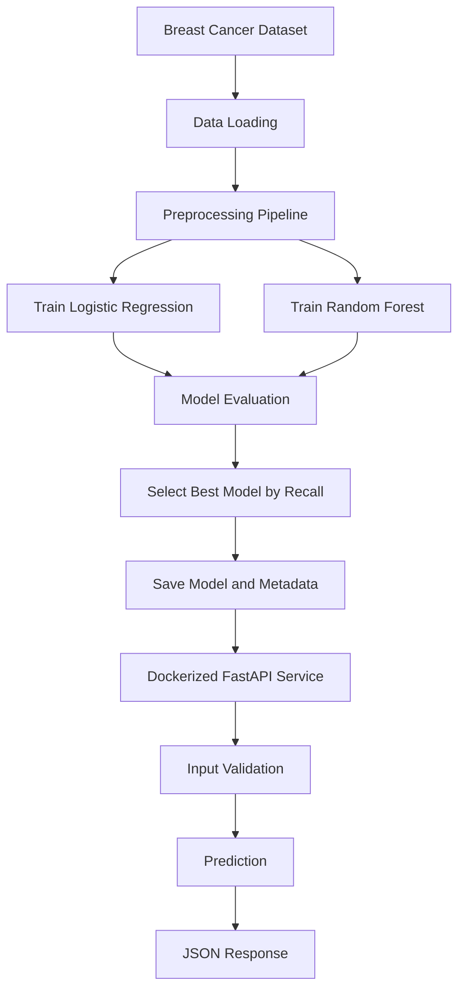

# Dockerized ML Training & Deployment Pipeline

An end-to-end Machine Learning project that automates model training, evaluation, selection, and deployment using **Scikit-learn, Docker, FastAPI, and Docker Compose**.

The project trains two classification models, selects the best-performing model based on Recall, saves the trained pipeline and metadata, and exposes predictions through a REST API.


## Project Overview

This project demonstrates how to move a machine learning workflow from experimentation to containerized deployment.

**Key capabilities:**

- Dataset preparation and preprocessing
- Training multiple machine learning classifiers
- Model evaluation using multiple classification metrics
- Automated model selection based on Recall
- Model serialization and version metadata
- REST API development with FastAPI
- Input validation using Pydantic
- Dockerized training and API services
- Service orchestration using Docker Compose
- Automated API testing with Pytest

## Architecture



## Tech Stack

| Category | Technologies |
|---|---|
| Language | Python |
| Data Processing | Pandas, NumPy |
| Machine Learning | Scikit-learn |
| Model Serialization | Joblib |
| API Development | FastAPI |
| Input Validation | Pydantic |
| Server | Uvicorn |
| Containerization | Docker |
| Orchestration | Docker Compose |
| Testing | Pytest |

## Dataset

**Breast Cancer Wisconsin Diagnostic Dataset**

The dataset is obtained from Scikit-learn's built-in breast cancer dataset.

| Property | Value |
|---|---:|
| Total records | 569 |
| Features | 30 |
| Target classes | 2 |
| Missing values | 0 |
| Training samples | 455 |
| Testing samples | 114 |

Target encoding:

- `0` = Benign
- `1` = Malignant

## Machine Learning Pipeline

### 1. Preprocessing

A Scikit-learn Pipeline combines:

- `SimpleImputer` — median imputation
- `StandardScaler` — feature standardization

Preprocessing is fitted on training data as part of each model pipeline.

### 2. Model Training

Two classifiers are trained:

- Logistic Regression
- Random Forest

### 3. Model Evaluation

Models are evaluated using:

- Precision
- Recall
- F1-score
- ROC-AUC

### 4. Model Selection

Recall is used as the predefined selection metric because identifying malignant cases is important in this classification task.

The model with the highest Recall is selected.

## Model Performance

| Metric | Logistic Regression | Random Forest |
|---|---:|---:|
| Precision | 0.9750 | 1.0000 |
| Recall | **0.9286** | 0.9048 |
| F1-score | **0.9512** | 0.9500 |
| ROC-AUC | **0.9960** | 0.9942 |

**Selected Model:** Logistic Regression

**Selection Metric:** Recall

The selected model and its evaluation metadata are saved using Joblib and JSON.

## Project Structure

```text
dockerized_ml_pipeline/
│
├── api/
│   ├── __init__.py
│   ├── Dockerfile
│   ├── main.py
│   └── schemas.py
│
├── data/
│   ├── dataset.csv
│   └── prepare_dataset.py
│
├── training/
│   ├── __init__.py
│   ├── Dockerfile
│   ├── data_loader.py
│   ├── preprocessing.py
│   ├── train.py
│   ├── evaluate.py
│   └── save_model.py
│
├── artifacts/
│   ├── best_model.joblib
│   └── metadata.json
│
├── tests/
│   ├── __init__.py
│   └── test_api.py
│
├── .dockerignore
├── compose.yaml
├── requirements.txt
└── README.md
```

## Getting Started

### Prerequisites

Install or configure:

- Python 3.11 or compatible local Python environment
- Docker Desktop
- Git

### 1. Clone the Repository

```bash
git clone https://github.com/YOUR_USERNAME/dockerized_ml_pipeline.git
cd dockerized_ml_pipeline
```

Replace `YOUR_USERNAME` with your GitHub username.

### 2. Install Dependencies

Create and activate a virtual environment:

```bash
python -m venv venv
```

Windows PowerShell:

```powershell
.\venv\Scripts\Activate.ps1
```

Install requirements:

```bash
pip install -r requirements.txt
```

### 3. Prepare the Dataset

```bash
python data/prepare_dataset.py
```

This generates `data/dataset.csv`.

### 4. Train and Evaluate Models

```bash
python -m training.save_model
```

The selected model and metadata are saved in the `artifacts/` directory.

### 5. Run Automated Tests

```bash
python -m pytest -v
```

**Verified result:** All 5 automated tests passed.

## Docker Deployment

The project uses separate Docker images for model training and API deployment.

### Build the Training Image

```bash
docker build -f training/Dockerfile -t ml-training:v1 .
```

### Run the Training Container

```bash
docker run --name ml-training -v "${PWD}/artifacts:/app/artifacts" ml-training:v1
```

The container trains both classifiers, selects the best model, and saves the artifacts.

### Build the API Image

```bash
docker build -f api/Dockerfile -t ml-api:v1 .
```

### Run the API Container

```bash
docker run -d --name ml-api -p 8000:8000 ml-api:v1
```

### Run with Docker Compose

Alternatively, start the configured services together:

```bash
docker compose up --build
```

Stop the services:

```bash
docker compose down
```

## API Documentation

Once the API is running, access:

| Endpoint | Method | Purpose |
|---|---|---|
| `/` | GET | API status |
| `/health` | GET | Health and model version |
| `/predict` | POST | Generate a prediction |
| `/docs` | GET | Interactive Swagger documentation |

### Example Prediction Request

Send a POST request to:

```text
http://localhost:8000/predict
```

Example JSON:

```json
{
  "mean_radius": 17.99,
  "mean_texture": 10.38,
  "mean_perimeter": 122.8,
  "mean_area": 1001,
  "mean_smoothness": 0.1184,
  "mean_compactness": 0.2776,
  "mean_concavity": 0.3001,
  "mean_concave_points": 0.1471,
  "mean_symmetry": 0.2419,
  "mean_fractal_dimension": 0.07871,
  "radius_error": 1.095,
  "texture_error": 0.9053,
  "perimeter_error": 8.589,
  "area_error": 153.4,
  "smoothness_error": 0.006399,
  "compactness_error": 0.04904,
  "concavity_error": 0.05373,
  "concave_points_error": 0.01587,
  "symmetry_error": 0.03003,
  "fractal_dimension_error": 0.006193,
  "worst_radius": 25.38,
  "worst_texture": 17.33,
  "worst_perimeter": 184.6,
  "worst_area": 2019,
  "worst_smoothness": 0.1622,
  "worst_compactness": 0.6656,
  "worst_concavity": 0.7119,
  "worst_concave_points": 0.2654,
  "worst_symmetry": 0.4601,
  "worst_fractal_dimension": 0.1189
}
```

Example response structure:

```json
{
  "prediction": 1,
  "class": "Malignant",
  "malignant_probability": 0.98,
  "model_version": "1.0.0"
}
```

*The probability above is illustrative; actual output depends on the submitted input.*

### Input Validation

Pydantic validates incoming patient features.

Invalid or missing fields result in HTTP `422 Unprocessable Entity` responses.

## Testing

The automated test suite checks:

1. Model loading
2. Health endpoint
3. Model version
4. Valid prediction
5. Invalid prediction and input validation

Run:

```bash
python -m pytest -v
```

**Result: 5 passed**

## Engineering Considerations

- Training and inference are separated into different services.
- Model preprocessing is included in the saved Scikit-learn pipeline.
- Model metadata records the selected model, version, evaluation metrics, and training timestamp.
- Pydantic validates prediction inputs.
- Docker provides consistent application environments.
- Docker Compose manages service startup and dependencies.

**Evaluation limitation:** The current implementation selects the model using Recall measured on the held-out test split. For a more rigorous evaluation, use a separate validation set for model selection and reserve the test set for final evaluation.

## Future Improvements

- Add a separate validation dataset for model selection.
- Automate model retraining.
- Add CI/CD with GitHub Actions.
- Add structured logging and monitoring.
- Add API authentication and rate limiting.
- Introduce model registry and version management.
- Add deployment to a cloud platform.

## Disclaimer

This project is developed for educational and machine learning engineering practice. It is not a clinically validated diagnostic system and must not be used for real medical decisions.

---

**Built as a practical Machine Learning Engineering project, covering model development, containerization, API deployment, and automated testing.**
